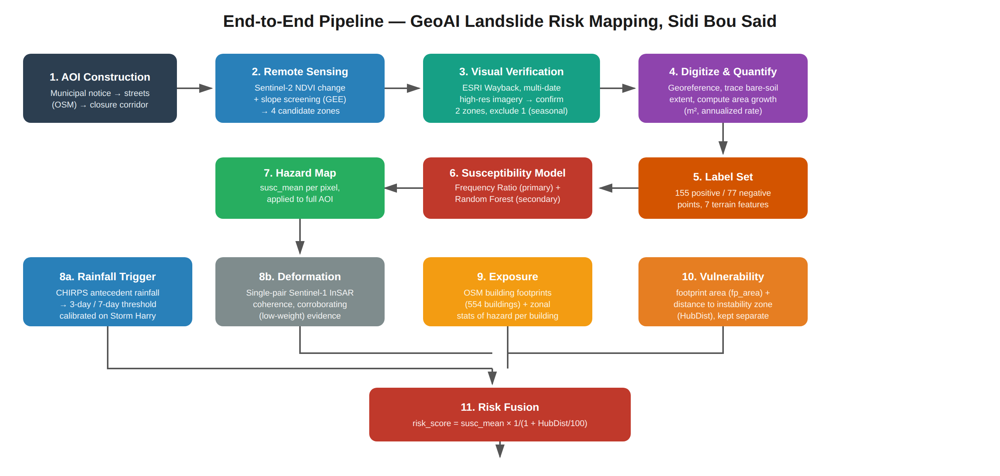
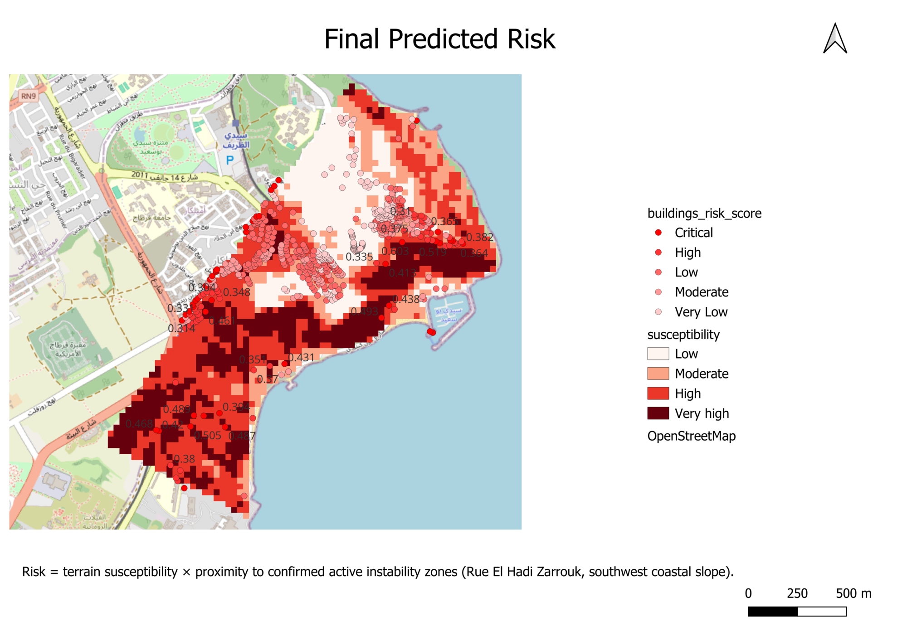

# GeoAI-Based Landslide and Slope-Failure Risk Mapping
### A per-building risk assessment for the Sidi Bou Said hillside, Tunisia

Internship project at the Association of Geospatial Intelligence (AGI), Tunis, by Zeineb Sinini (Manouba School of Engineering).

## Overview
In January 2026, Storm Harry brought nearly 300 mm of rain in 48 hours to Sidi Bou Said. With no formal regional landslide inventory, this project builds its own labels from satellite evidence and produces a per-building landslide risk ranking.



## Pipeline
1. **AOI** built from the municipal closure notice (OpenStreetMap).
2. **Labels**: Sentinel-2 NDVI change, slope screening and multi-date high-resolution imagery. Two confirmed instability zones give 155 positive points, plus 77 negative points (223 usable after terrain sampling).
3. **Susceptibility**: Frequency Ratio and Random Forest on 7 terrain covariates, plus an elevation sensitivity check. Slope, TRI and aspect are the converged drivers.
4. **Triggers (supporting evidence)**: CHIRPS antecedent rainfall and a single Sentinel-1 InSAR coherence pair.
5. **Risk fusion**: `risk_score = susc_mean x 1 / (1 + HubDist/100)` for 554 OSM buildings.



## Key results
| Metric | Value |
|---|---|
| Random Forest AUC (leave-one-out) | 0.958 (0.884 without elevation) |
| Frequency Ratio, steepest slope bin | 1.38 |
| Frequency Ratio, roughest TRI bin | 1.41 |
| Mean InSAR coherence (Zarrouk / Southwest / stable) | 0.44 / 0.47 / 0.51 |
| Buildings scored | 554 |

## Repository structure
- `notebooks/01_susceptibility_modeling.ipynb`: Frequency Ratio, Random Forest, sensitivity check, susceptibility maps
- `notebooks/02_building_footprints_osm.ipynb`: OSM building footprints for the AOI
- `gee/gee.js`: Google Earth Engine scripts
- `data/`: labels, terrain rasters, AOI
- `outputs/`: figures and maps
- `docs/`: full report and poster

## How to run
```bash
pip install -r requirements.txt
```
Run the notebooks in order, and run the cells within each notebook from top to bottom.

## Limitations
Single-event calibration; validation is partly circular (the proximity term uses zones inside the closure corridor); CHIRPS is coarse (~5.5 km); a single InSAR pair gives only weak evidence; vulnerability uses proxies only. See `docs/AGI_report.pdf`.

## Data sources and credits
Sentinel-1/2 (Copernicus), Copernicus DEM GLO-30, CHIRPS, ESRI World Imagery Wayback, and OpenStreetMap contributors (ODbL).
